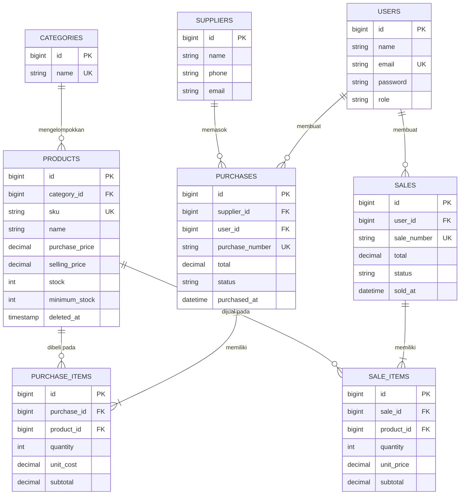

# ERD & Relasi Eloquent

## ERD

## Relasi Eloquent

| Model | Relasi |
|---|---|
| Category | `hasMany(Product)` |
| Product | `belongsTo(Category)`, `hasMany(SaleItem)`, `hasMany(PurchaseItem)` |
| Supplier | `hasMany(Purchase)` |
| Purchase | `belongsTo(Supplier)`, `belongsTo(User)`, `hasMany(PurchaseItem)` |
| PurchaseItem | `belongsTo(Purchase)`, `belongsTo(Product)` |
| User | `hasMany(Sale)`, `hasMany(Purchase)` |
| Sale | `belongsTo(User)`, `hasMany(SaleItem)` |
| SaleItem | `belongsTo(Sale)`, `belongsTo(Product)` |

### hasMany vs belongsTo

- `hasMany` dipakai di sisi **induk** ("satu Sale punya banyak SaleItem").
- `belongsTo` dipakai di sisi **anak** yang menyimpan foreign key ("SaleItem milik satu Sale").
- Foreign key (`sale_id`) berada di tabel **detail** karena satu baris induk dapat memiliki banyak baris anak;
  kolom FK pada tabel anak menunjuk ke satu induk. Kebalikannya (menyimpan banyak id di tabel induk) melanggar
  normalisasi.

### Integritas data (foreign key)

- `products.category_id` → `restrictOnDelete`: kategori yang masih punya produk tidak bisa dihapus.
- `purchase_items.product_id`, `sale_items.product_id` → `restrictOnDelete`: produk bertransaksi tidak bisa di-hard-delete.
- `purchase_items.purchase_id`, `sale_items.sale_id` → `cascadeOnDelete`: detail ikut terhapus bila header dihapus.
- Index tambahan: `products.name`, `sales.sold_at`, `sales.status`, `purchases.purchased_at`, `purchases.status`, `users.role`.
